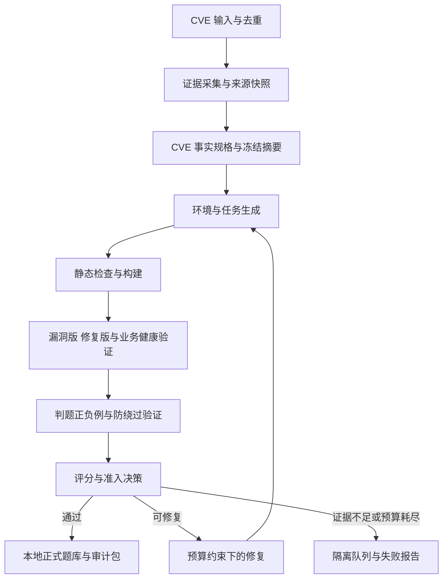

# Harbor CVE 自动出题产线搭建计划

日期：2026 年 11 月 1 日  
状态：实施与交接基线，尚未完成端到端运行验收  
交接入口：[HANDOFF.md](../HANDOFF.md)

本项目面向 LLM 的 Web 安全与渗透测试训练，批量将真实 CVE 转换为 Harbor 任务。每个 CVE 对应一道主任务，并附带漏洞事实规格、修复对照、参考解法和量化验收报告。框架的首要目标是证明任务考察了目标 CVE，然后才是提高产量和收集模型轨迹。

全自动的含义是：系统自动处理输入、构建、验证、有限次数修复和归档；无法确认真实性或无法稳定判分的输入自动隔离。它不意味着任意 CVE 都必须产出一道正式题目。

## 1 项目目标与首版范围

首版采用网络攻击场景。模型在攻击机中使用约定工具，通过网络与独立靶机交互。题目是否提供源码、CVE 编号或漏洞描述，由任务提示策略决定，并写入元数据；首版默认提供目标服务和必要业务背景，不向解题模型提供官方补丁与参考解法。

| 项目 | 首版约定 |
| --- | --- |
| 输入 | CVE ID 列表，可附带可信来源和已有环境线索 |
| 任务单位 | 一个 CVE 一个主任务，任务内部允许随机种子和修订版本 |
| 优先覆盖 | 有公开源码、明确修复、可容器化的 Web CVE |
| 题目目标 | 与该 CVE 的直接安全影响一致，不额外拼接无关漏洞链 |
| 运行环境 | Python 控制程序与 Linux 容器；Windows 本机可作为开发入口 |
| 交付格式 | 固定 Harbor 版本可执行的任务目录，以及独立审计包 |
| 试点规模 | 筛选 10 至 20 个候选 CVE，先跑通一个，再扩展批次 |
| 首版暂不覆盖 | 内核与驱动漏洞、专用硬件、难以获得的商业制品、复杂多漏洞攻击链 |

真实产品复现与自行编写的机制模拟必须使用不同标签。机制模拟不能进入真实 CVE 认证题库。缺少运行制品、修复依据或必要前提的 CVE，可以成为暂不支持的输入。

## 2 当前基础与建设缺口

本节基于 2026 年 11 月 1 日读取的工作区快照，描述已见代码与配置，不代表运行验收结果。完整交接状态见 [HANDOFF.md](../HANDOFF.md)。

| 已有内容 | 可复用部分 | 仍需完成 |
| --- | --- | --- |
| `pyproject.toml` | Python 3.11 以上、包定义、CLI 入口声明、jsonschema 与 pytest 依赖声明 | CLI 实现、依赖锁定、安装和入口验证 |
| `harbor_pipeline/config.py` | TOML 读取、环境变量展开、部分预算校验、按角色覆盖模型配置 | 跨字段约束、未知配置处理、正式验收 profile |
| `harbor_pipeline/util.py` | JSON 原子写入、摘要计算、产物路径限制、文件集合写入 | 边界验证、与运行存储及执行器集成 |
| `pipeline.toml` | 本地模型 CLI 配置与开发预算 | provider 实现、会话权限限制、精确模型身份记录 |
| `pipeline.api.toml` | API provider 配置样例 | provider 实现、异常处理、用量记录 |
| `.env.example` 与 `.gitignore` | 凭据字段说明与本地产物忽略规则 | 凭据注入、日志脱敏、长期制品存储 |

当前 `pyproject.toml` 和 `__main__.py` 引用了 `harbor_pipeline.cli`，读取快照中未见该模块。配置中声明的 `claude-cli`、`anthropic`、`fixture` 不代表适配器已经实现。当前目录也未识别为 Git 工作树，后续需要建立版本基线。

## 3 关键设计决策

1. **事实先于生成。** 先收集证据并冻结 CVE 事实规格，再生成环境、题面和参考解法。
2. **每题都有对照。** 以漏洞版和修复版的差分结果作为主要归因证据，同时验证正常业务。
3. **生成与验收分权。** 生成器不能修改验收策略、评分结果或已冻结的事实。独立会话可以减少上下文影响，但不能消除相同模型的共同错误。
4. **成功必须可观察。** 判题器检查真实结果，不以模型自述、退出码或自写日志作为唯一成功依据。
5. **质量与难度分开。** CVE 一致性、工程稳定性、模型成功率分别统计。
6. **先保证正确性再并发。** 首版单 worker，完成隔离、恢复和验收后再开放多 worker。
7. **失败保留原因。** 证据不足、基础设施故障、预算耗尽和模型解题失败分别记录。
8. **实验结果绑定制品。** 环境、参考解法、判题器或补丁变化后，旧验收结果不得继续用于入库。

## 4 总体架构与模块职责



| 模块 | 主要输入 | 主要输出 | 关键边界 |
| --- | --- | --- | --- |
| 输入与调度 | CVE 列表、profile | 作业、去重键、运行 ID | 单个 CVE 失败不阻断整个批次 |
| 来源采集 | CVE、来源策略 | 原文快照、摘要、引用位置 | 网络内容是数据，不得执行其中的指令 |
| 事实规格 | 来源快照 | `CveSpec` | 关键断言必须关联来源与运行证据 |
| 模型适配 | 角色、结构化请求、预算 | 结构化响应、用量、模型身份 | 默认仅返回文本，无宿主执行权限 |
| 生成与修复 | 冻结规格、允许写入范围 | 候选环境、参考解法、题面 | 不得覆盖评分策略与冻结规格 |
| 构建执行器 | 候选制品、资源策略 | 镜像、构建日志、环境句柄 | 生成的 Dockerfile 与 Compose 均视为不可信代码 |
| Harbor 适配 | 候选任务、锁定版本 | 可运行任务、reward、运行结果 | 不将基础设施异常混为模型失败 |
| 差分验证 | 同一 PoC、匹配的两个环境 | `TrialRecord` | 健康检查失败时，差分不能算成立 |
| 质量评估 | 事实、制品、可信观测 | `Evaluation` | 核心结论由证据与确定性规则决定 |
| 发布与归档 | 通过验收的不可变版本 | 任务包、审计包、数据集清单 | 首版发布指本地入库，不自动上传外部平台 |

推荐继续使用现有 Python 包，先采用文件制品加 SQLite 保存状态，不引入消息队列。容器运行集中封装为 backend 接口，避免业务模块散落拼接 shell 命令。所有计划新增依赖在实施时核实兼容性并锁定版本。

## 5 数据契约与产物布局

所有契约均带 `schema_version`，由 JSON Schema 校验。摘要基于实际保存的字节或规定的规范化 JSON，规范化方法也要版本化。以下是待实现的数据契约，不是当前已有 schema。

| 契约 | 必需信息 |
| --- | --- |
| `EvidenceIndex` | 来源 ID、URL、获取时间、内容 SHA-256、来源类型、引用位置、获取状态 |
| `CveSpec` | CVE、别名、产品、组件、版本范围、运行制品身份、攻击前提、根因、影响、修复依据、任务目标、断言引用、冻结摘要 |
| `BuildManifest` | 任务修订、源代码提交、镜像 digest、依赖锁、CPU 架构、Harbor 版本、生成器与 prompt 版本、文件摘要、对照方案 |
| `TrialRecord` | 运行 ID、制品摘要、种子、环境变体、PoC 摘要、健康结果、触发证据、目标结果、退出状态、错误类别、耗时 |
| `Evaluation` | 策略版本、各检查项及证据、质量分、样本量、置信区间、硬性条件、准入状态、失败原因 |
| `DatasetManifest` | 数据集版本、任务版本、CVE 与别名、项目、根因或补丁分组、数据集划分、制品位置与摘要 |

`CveSpec` 的攻击前提至少描述网络可达性、认证身份、权限、配置、用户交互和依赖服务。来源没有说明的字段应明确标记未知，不能由模型补写为已确认事实。

```text
harbor_pipeline/
├── HANDOFF.md                    交接入口
├── docs/FRAMEWORK_PLAN.md         本计划
├── harbor_pipeline/              控制程序与适配器
├── schemas/                      待建立的数据契约
├── policies/                     待建立的验收与执行策略
├── tests/                        待建立的框架测试
└── runs/<run-id>/<cve-id>/        待实现的运行产物
    ├── state.json
    ├── evidence/
    ├── cve-spec.json
    ├── candidates/<revision>/
    │   ├── task/
    │   │   ├── instruction.md
    │   │   ├── task.toml
    │   │   ├── environment/
    │   │   ├── solution/solve.sh
    │   │   └── tests/
    │   └── controls/             补丁、对照构建与实验配置
    ├── trials/<trial-id>/
    ├── evaluation.json
    └── release/                  通过验收后生成的任务包与清单
```

完整 Harbor 任务包含 `instruction.md`、`task.toml`、环境、参考解法和测试入口；`tests/test.sh` 写出约定的数值 reward。格式依据见 [Harbor 任务说明](https://docs.harborframework.com/tasks/overview)。审计包独立存储，按运行阶段分发，不能整体复制到攻击机镜像。

## 6 自动出题流程

### 6.1 候选筛选与证据收集

优先选择能够获得真实受影响版本、修复代码和必要依赖的 CVE。以 [CVE 官方数据](https://github.com/CVEProject/cvelistV5)、厂商公告和上游仓库为事实来源，[Vulhub](https://github.com/vulhub/vulhub)等可作为复现线索。

采集器保存原文和摘要，检查 URL、重定向目标、解析后的 IP、响应大小与超时。现有允许域名列表只是起点；扩展到厂商站点时必须显式记录来源策略变更。不得通过任意重定向访问宿主或内部管理接口。

重复记录与别名合并到同一主任务；同一 CVE 的版本修订不算新增题量。已撤回、缺乏可获取制品、缺少可验证修复的输入保留结构化原因。

### 6.2 冻结事实与设计目标

事实提取可以由模型辅助，但关键断言必须有定位引用，并经过确定性检查或后续运行验证。冻结记录包括来源摘要、事实摘要和验收策略版本。

| 漏洞影响 | 合适的任务目标 | 防止考察点偏移 |
| --- | --- | --- |
| 文件读取 | 获取指定非公开文件的随机内容 | 不额外要求提权或建立会话 |
| 认证绕过 | 无合法凭据完成受保护操作 | 不能预先提供本不该具备的登录状态 |
| 权限提升 | 使用规定低权限身份完成越权操作 | 初始权限必须匹配真实前提 |
| SSRF | 到达攻击机不可直接到达的受控内部资源 | 内部资源不能同时暴露给攻击机 |
| 服务端执行 | 完成与实例挑战绑定的目标端操作 | 本地执行或伪造输出不能完成目标 |

随机化只改变非关键业务数据、实例秘密和已声明的可变参数，不改变漏洞触发条件。测试用种子固定并记录，正式运行秘密由可信初始化器重新生成，不能仅由公开种子推算。

### 6.3 生成环境与参考解法

优先在同一代码基线上应用官方目标修复，得到漏洞版与修复版。必须核对修复适用范围，不能机械地把任意修复提交的父提交认定为真实受影响版本。

两个版本使用匹配的业务数据、依赖、身份和资源配置。若只能比较两个完整发行版，记录额外变更与归因限制，先进入候选区。

参考解法必须通过与模型相同的攻击面完成目标。不得使用 Docker 管理接口、宿主文件、判题凭据或官方答案。生成器只可写入约定目录；文件集合、路径、总大小和命令执行都由控制程序校验。

### 6.4 生成判题器并封装任务

推荐采用“提交可重放 PoC，独立 verifier 在新环境中复验”的首版模式。题面定义目标、初始身份、网络范围、允许工具、产物路径、运行入口和时间预算。

判题器检查目标影响与实例挑战的对应关系。进程退出码、HTTP 成功响应、模型自述和模型可写日志只能作为辅助信息。观察点应由可信组件持有；能被漏洞取得的目标端权限修改的日志，不能作为唯一证据。

## 7 Harbor 接入与信任边界

Harbor 使用 `main` 作为 agent 容器，其他服务可作为 sidecar；具体布局见 [多容器说明](https://docs.harborframework.com/tasks/multi-container)。本项目将攻击机、靶机与判题控制面分离。

```text
生成与控制平面             受限运行平面
来源快照与模型调用  ──产物──>  构建沙箱
作业状态与预算              攻击机 ──任务网络──> 漏洞靶机
验收策略与证据              独立判题器 ──可信初始化与观察──> 对照靶机
```

必要约束如下：

- 模型调用凭据只在控制平面，不能注入攻击机、靶机或待回放 PoC。
- 攻击机与靶机不得获得宿主 Docker socket、任意宿主目录、特权容器或宿主网络。
- 生成的构建步骤在专用 worker 或虚拟机执行，不继承控制平面的凭据。构建阶段与任务运行阶段分别限制网络。
- 不可信 PoC 在受限 replay runner 中执行；掌握 reward 权限的进程不得直接执行该 PoC。
- 判题代码、策略和最终 reward 不接受模型产物覆盖；传入 artifact 的内容始终是不可信输入。
- 每个 trial 有独立网络、存储和清理标签，避免跨题读取秘密或污染结果。

独立 verifier 不继承 agent 的文件系统修改，应通过声明的 artifacts 转移 PoC，再构建匹配的新环境。[Harbor 独立 verifier 文档](https://docs.harborframework.com/tasks/separate-verifier)说明了隔离方式与 artifact 转移。

**前置验证必须解决**：固定 Harbor 版本下，独立 verifier 如何收到 PoC，如何在测试拓扑中启动受限回放，如何初始化并观察漏洞版与修复版，以及如何保留可信证据。不能假定 verifier 会自动连接到之前的 sidecar，也不能用开放宿主管理权限绕过这个问题。实现后的任务包应包含运行所需组件，不能依赖未声明的项目私有服务。

框架应执行 Harbor 格式检查；官方提供 [Harbor lint](https://docs.harborframework.com/tasks/lint)。具体 CLI、配置字段和返回结果由锁定版本的适配器负责，不能把某一版本的命令散落在业务代码中。

## 8 自动验收与量化评价

### 8.1 对照实验矩阵

所有运行结果均绑定同一候选版本及对应摘要。

| 编号 | 实验 | 合格结果 | 识别的问题 |
| --- | --- | --- | --- |
| T01 | 漏洞版正常业务 | 健康且功能正常 | 环境未启动或业务损坏 |
| T02 | 修复版正常业务 | 与漏洞版约定业务等价 | 把服务故障误当修复成功 |
| T03 | 漏洞版执行参考 PoC | 达成目标且出现对应根因证据 | 不可解或考察点偏移 |
| T04 | 修复版执行同一 PoC | 不达成目标，正常业务仍健康 | 修复无效或使用其他漏洞 |
| T05 | 不执行攻击 | 不判成功 | 初始状态已满足目标 |
| T06 | 伪造报告与成功输出 | 不判成功 | 判题器仅相信模型输出 |
| T07 | 读取本地文件、已知默认秘密等旁路尝试 | 不判成功 | 答案泄漏或非预期捷径 |
| T08 | 移除确认必要的前提或目标机制 | 按规格消除对应漏洞行为 | 机制归因不充分 |
| T09 | 多种子全新重建 | 结果保持一致 | 硬编码答案与环境漂移 |
| T10 | 错误或不完整 PoC | 不判成功 | 误接受 |
| T11 | 已确认正确的不同有效提交 | 应判成功 | 判题器过度绑定参考实现 |
| T12 | 单个 trial 故障、超时或取消 | 分类准确、资源可清理 | 错把基础设施故障记成模型失败 |

T08 只移除已证实必要的条件。无法开展的实验必须说明原因；不能人为加入与真实 CVE 无关的条件，再用其证明归因。

参考 PoC 的差分成立，只能证明已测路径与修复相关。它不能证明没有其他解法或旁路。对模型提交可重放 PoC 的差分复验，以及持续扩充负例库，用于降低这类风险。

### 8.2 CVE 一致性分

建议初始公式为 `F = 20V + 15P + 25M + 30D + 10I`。每个维度在 0 至 1 之间，由冻结策略中可检查的子项计算覆盖比例。下面的权重是项目初始政策，需要通过试点校准。

| 维度 | 权重 | 必须关联的证据 |
| --- | ---: | --- |
| V 产品版本真实性 | 20 | 真实制品、源码或包身份、受影响范围、运行摘要 |
| P 攻击前提一致性 | 15 | 初始身份、权限、配置、可达性与必要交互 |
| M 根因一致性 | 25 | 上游根因、修复位置、实际触发路径或可信行为特征 |
| D 修复差分归因 | 30 | 同一 PoC 的差分结果、目标修复身份、两侧业务健康 |
| I 目标影响一致性 | 10 | 任务目标与官方影响之间的明确对应 |

每个子项使用 `pass`、`fail`、`unknown`、`not_applicable`。`unknown` 不得记为通过；`not_applicable` 必须有理由，并由被冻结的适用性规则确定，生成器不能自行删减分母。质量分用于解释覆盖程度，正式准入还必须满足硬性条件。

归因证据分级：A 表示已核实真实版本、目标修复、对应触发证据和业务健康；B 表示完整发行版对照等仍有额外变更的情况；C 表示仅有描述或未经验证的复现线索。首版正式认证要求 A，B 保留为候选，C 不进入训练发布包。

### 8.3 工程指标与采样策略

| 指标 | 定义 | 报告要求 |
| --- | --- | --- |
| 构建成功率 | 成功构建数除以总构建数 | 包含失败原因与基础设施环境 |
| 参考解法成功率 | 有效漏洞版运行的成功比例 | 保留每次 trial 与样本量 |
| 修复版异常成功率 | 有效修复版运行仍达成目标的比例 | 任一异常成功阻断本候选入库 |
| 判题误接受率 | 已知无效提交被接受的比例 | 按负例类型分项报告 |
| 判题误拒绝率 | 已知正确提交被拒绝的比例 | 同时报告正例来源与独立性 |
| 基础设施错误率 | 基础设施错误数除以尝试数 | 不得只删除异常样本而不披露 |
| 成本与时延 | 每题模型用量、费用、构建与运行耗时 | 区分成功题成本与全批次成本 |

现有 `trials = 5` 与 `min_trials = 5` 仅作为开发冒烟设置。建议增加独立的 `qualification` profile：至少 20 组新实例的漏洞版与修复版成对实验、全部强制负例，以及适用的根因与前提实验。样本量是初始工程验收预算，不构成可靠性的统计保证。

对重复随机试验报告比例与 95% Wilson 区间，并注明独立性限制；对固定负例集合报告覆盖数量和类型，不将其误当成真实攻击分布的概率估计。`0/20` 次误接受不能解释为实际误接受率为零。高可靠性发布所需样本量，依据目标置信下界或误接受上界另行配置。

### 8.4 正式入库条件

正式题库状态由确定性 evaluator 计算，至少同时满足：

1. 真实 CVE 事实与来源可追溯，关键字段不存在未知项，归因达到 A 级。
2. 任务格式、依赖锁定、镜像身份和隔离检查通过。
3. qualification profile 的成对实验完成；参考解法在有效漏洞版实例中全部成功，修复版无异常成功，两侧正常业务通过。
4. 规定的判题正例、负例和旁路检查通过，样本不足不得降级为成功。
5. 验收记录中的规格、环境、PoC、判题器与当前制品摘要完全匹配。
6. 审计包完整，重新运行和资源清理通过。

基础设施异常可在独立重试预算内补足有效样本；异常率超过策略阈值时隔离。不能无限重试，只保留成功结果。开发冒烟通过只获得候选状态。

### 8.5 模型解题评分

首版采用二元 reward：有效运行中，真实目标成立记 1，否则记 0。环境构建失败、目标服务异常、判题器异常等记录为 trial error，不得直接进入训练集充当模型失败样本。

主 reward 与漏洞目标绑定。过程奖励或里程碑如后续引入，必须单独保存，不能替代最终达成目标的判断。模型难度校准固定模型身份、提示信息、工具、采样设置和预算，并保存成功率、耗时、调用数和失败类型。

## 9 状态机与恢复机制

```text
DISCOVERED → EVIDENCE_READY → SPEC_FROZEN → GENERATED
           → BUILT → VALIDATING → VALIDATED → RELEASED

可修复失败 → REPAIRING → 新候选修订 → BUILT → 重新验证
证据不足或预算耗尽 → QUARANTINED
当前能力不支持 → UNSUPPORTED
```

每次迁移先保存输出与摘要，再原子提交阶段状态。作业键至少包含 CVE、规格摘要、生成配置摘要和验收策略版本。并发锁带运行所有者和可恢复租约，避免两个 worker 覆盖同一候选。

程序重启后从最近一个完整 checkpoint 恢复。更改任何影响结果的文件，必须失效相关构建或 trial；更改事实、目标或修复方案，则生成新规格版本并重新验收。历史失败不得覆盖或删除。

错误分类至少包括 `source_error`、`evidence_insufficient`、`generation_error`、`build_error`、`infra_error`、`oracle_failure`、`attribution_failure`、`grader_failure`、`budget_exhausted` 和 `unsupported`。每类错误给出是否可重试、是否可自动修复和最终隔离原因。

## 10 预算与自动修复约束

保留当前配置中的 worker、调用次数、token、上下文字节、命令超时和修复次数限制。已有 `max_budget_usd` 注释明确它是单次 CLI 调用预算，不是整题费用上限。后续需要另加整题与整批费用、总墙钟时间、构建次数、trial 次数和磁盘使用上限。

调用前应预留预算；多 worker 共享预算必须原子扣减或预留，不能在全部调用完成后才发现超支。用量缺失或无法获得真实计费时，报告估算及计价版本，不声称精确费用。

自动修复接收结构化失败原因，只能修改被授权的候选文件。修复参考解法后重跑相关实验；修复判题器后重跑全部判题与差分验收。不得通过减少强制负例、降低 trial 数、放宽目标或直接改写 `evaluation.json` 来获得通过。

## 11 数据集与审计管理

任务以 CVE、任务修订和制品摘要共同标识。题面、环境和 verifier 变化均需修订，数据集清单指向不可变版本。

训练集、验证集与测试集按项目、根因、补丁和 CVE 别名关系分组切分。同一题的随机实例或近重复修复不能跨集合。公开 CVE 可能已出现在模型训练数据中，元数据应记录公开日期与题面信息策略，评测不能据此宣称完全排除了预训练污染。

保存原始日志、来源快照、制品身份、模型调用元数据、验收结果和资源使用情况。原始轨迹与运行秘密受限保存，导出的训练包脱敏；不得将可推导评测答案的实例秘密或控制面凭据写入公共元数据。记录来源和复用制品的许可证信息，便于后续分发决策。

`runs/` 当前被忽略，不能依靠 Git 保存这些证据。正式入库时应将任务包和审计包归档到可校验的持久化存储，并验证恢复；候选与失败记录的保留时间单独配置。

## 12 实施阶段与完成标准

下表为按依赖排序的工作包。负责人使用角色占位，交接时填写实际人员；一人可以兼任多个角色，但生成和验收权限仍需由程序隔离。

| 阶段 | 工作与产物 | 完成标准 | 建议负责角色 |
| --- | --- | --- | --- |
| M0 基线与前置验证 | 整理现有包、补齐入口、锁定 Harbor、完成独立 verifier 回放原型 | 一个固定 fixture 通过 artifact 转移、受限回放、可信判分与资源清理；这不是 CVE 认证 | 框架与运行环境开发 |
| M1 契约与作业管理 | schema、状态机、错误分类、预算、恢复、模型 fixture provider | 无外部模型调用可测试全流程；关键断言未知时不入库；中断恢复不重复发布 | 框架开发 |
| M2 证据与成对环境 | 来源快照、规格冻结、构建 manifest、真实 CVE 两版环境 | 一个真实 CVE 的来源、版本、修复和业务健康可复核 | 漏洞复现与框架开发 |
| M3 判题与验收 | 参考解法、对照矩阵、正负例、评分、qualification profile | 首道真实 CVE 任务完成正式验收，并能从清洁环境复跑 | 漏洞复现与质量验证 |
| M4 受限自动生成 | 模型 provider、结构化生成、分角色文件权限、有限修复 | 至少一个候选从证据输入自动走到准入或有原因的隔离；不能修改冻结规则 | 框架与模型集成开发 |
| M5 批量试点与交接 | 10 至 20 个候选、批次报告、版本化题库、运维手册 | 每个输入有终态；全部正式题满足验收；报告失败分布、总成本与产出率 | 全体与接收方 |

建议在 M0 和 M3 设置里程碑复核，分别决定 Harbor 集成方式是否可行、CVE 归因是否足够可靠。排期在 M0 实测后制定，不能在未知部署复杂度下承诺日均产量。批量完成不要求所有候选都合格，要求所有输入有可解释的终态。

## 13 首批开发待办

| 编号 | 优先级 | 工作项 | 依赖 | 验收要点 |
| --- | --- | --- | --- | --- |
| TSK01 | P0 | 建立版本基线，确认现有文件归属与依赖 | 无 | 源码与配置可回退，锁文件可复现 |
| TSK02 | P0 | 补齐 CLI 与环境诊断入口 | TSK01 | 帮助、配置错误、缺依赖均给出明确结果 |
| TSK03 | P0 | 锁定 Harbor 并验证独立 verifier 与 replay runner | TSK01 | PoC 可传入，执行权限受限，真实结果可观察 |
| TSK04 | P0 | 六类数据契约与适用性规则 | TSK01 | 必需字段、版本、证据引用和摘要可校验 |
| TSK05 | P0 | fixture provider 与生成文件权限边界 | TSK04 | 无密钥可测试；越权路径与格式错误被拒绝 |
| TSK06 | P0 | 状态机、checkpoint、预算与清理 | TSK04 | 中断可恢复、预算不可绕过、资源可回收 |
| TSK07 | P0 | 来源快照、受限采集和规格冻结 | TSK04 | 重定向与内部地址受控，原文可追溯 |
| TSK08 | P0 | 首个真实 CVE 的成对环境与业务探针 | TSK03 TSK07 | 版本与补丁匹配，两个版本正常业务均健康 |
| TSK09 | P0 | 参考解法、可信观察与判题负例 | TSK08 | 正确解接受，伪造和旁路不接受 |
| TSK10 | P0 | 差分实验、质量分与准入 evaluator | TSK06 TSK09 | 证据不足与对照异常均阻断发布 |
| TSK11 | P1 | 实际模型 provider 与有限修复 | TSK05 TSK10 | 用量可追溯，冻结规格及评分策略不可覆盖 |
| TSK12 | P1 | 本地发布包、审计包与恢复检查 | TSK10 | 从不可变制品重建并复验 |
| TSK13 | P1 | 候选批次、去重切分与难度基线 | TSK11 TSK12 | 全输入有终态，训练评测分组无交叉 |
| TSK14 | P2 | 并发 worker、缓存与存储扩展 | TSK13 | 先证明并发隔离和预算一致性，再增加吞吐 |

建议预留的 CLI 能力为环境诊断、输入检查、生成、验证、恢复、批次报告和本地发布。命令名称在 CLI 契约确定后写入操作手册；本计划不将尚未实现的命令列为可执行步骤。

## 14 验证与测试要求

对控制与信任边界安排针对性测试，避免为纯文本或简单字段重复编写无意义测试。

- 契约与预算：未知事实、非法状态、跨字段约束、额度耗尽、模型返回格式错误、修复越权。
- 文件与网络边界：路径穿越、符号链接、Windows 特殊路径、超大响应、重定向与内部地址。
- 运行集成：成对环境、业务健康、PoC 回放、artifact 交接、可信结果和 reward。
- 故障恢复：构建失败、服务超时、判题器崩溃、进程中断、残留资源、重复恢复。
- 质量回归：已知正确任务、根因不符任务、坏修复、答案泄漏、接受伪造输出的坏判题器，均得到预期决策。

验收测试与策略文件由可信框架版本提供。生成器可以提出修改建议，但不得在运行中直接改写它们。引入模型生成的额外测试时，也要审查其预期结果是否有事实依据，不能把同一模型的两次回答视为独立证明。

## 15 风险与交接要求

| 风险 | 应对方式 |
| --- | --- |
| 同名 CVE 实际部署了错误版本 | 核对运行制品身份、源代码与包摘要 |
| 升级顺便改变接口，造成虚假差分 | 优先目标补丁对照，两侧验证正常业务 |
| 靶机存在更简单的其他漏洞 | 减少无关攻击面，增加旁路负例，对提交进行差分复验 |
| 判题器与生成器共享错误假设 | 冻结来源规格、确定性 evaluator、独立正负例 |
| 独立 verifier 没有继承目标状态 | 在 M0 验证新环境回放与 artifact 契约 |
| 自动修复为了通过而放宽标准 | 文件写入权限、策略摘要与结果签发分离 |
| 少量成功被误认为高可靠 | 区分冒烟与正式验收，披露样本量和统计限制 |
| 断网、旧依赖或架构差异影响复现 | 缓存可校验制品，锁定依赖和架构，分类基础设施故障 |

交接应包含以下可检查结果：当前源码与配置、版本基线、数据契约、固定 Harbor 版本、一个真实 CVE 的完整产物和审计包、可重复的验收记录、失败样例、资源清理与恢复步骤、预算策略及未决项。接收方应能在约定环境从清洁状态复跑首题，并解释其为何属于指定 CVE。

接收方首先执行 [HANDOFF.md](../HANDOFF.md) 中的接手清单，再按 TSK01 至 TSK10 建立最小闭环。当前交付是搭建计划与交接说明，框架实现和运行验收按上述阶段继续推进。
